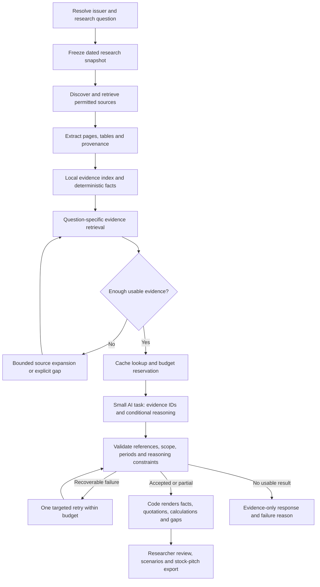

# Implementation plan: efficient, evidence-led equity research

Prepared 14 October 2026. **Status: proposed implementation, not completed functionality.** This plan follows inspection of the current code and the live Gemini failures recorded in `VALIDATION.md`. Existing behavior is identified separately below. The intended first deployment remains the current local, single-user Indian-equity research product.

## 1. Decision and definition of success

Improve collection, retrieval and the AI contract before buying capacity. Code should retrieve documents, preserve provenance, normalize financial data, calculate results and render citations. AI should work on narrowly defined questions, select evidence references and produce explicitly conditional interpretations. The researcher chooses assumptions and investment conclusions.

Optimize **cost per useful, reviewed answer**, not just tokens per request or the percentage of sections filled. A cheap answer with missing contrary evidence is not an improvement. Neither a filled report nor a matching quotation establishes a correct investment thesis.

The first release must support any issuer that can be resolved and researched through supported sources. It must return specific gaps for unsupported issuers, unavailable disclosures and failed sources. It must not require company-specific answer dictionaries.

## 2. What is implemented and what the evidence actually says

| Existing behavior | Observed limitation | Planned response |
| --- | --- | --- |
| Generic NSE/company-site discovery; up to 12 attempts for six issuer documents | Six documents can still omit a decisive filing; BSE automatic feed discovery is absent | Coverage-driven discovery with bounded expansion and exchange adapters |
| PDF/HTML reading, hashes, page citations and conservative relationship extraction | PDF text is reduced to keyword excerpts and the best ten passages per category; later retrieval cannot search discarded text | Retain a bounded page/block index before selecting excerpts |
| Explicit income-table parsing and financial reconciliation | General balance-sheet/cash-flow tables, scans and many layouts remain unsupported | Extend measured parser coverage; preserve unknown basis and skipped tables |
| Category-balanced AI context: 28,000 filing characters, provider description and financial tables | One large request covers twelve sections; budgets use characters rather than measured tokens | Retrieve by question, deduplicate and impose aggregate token budgets |
| Gemini, structured JSON, strict local validation, project-aware key rotation | Valid JSON can still contain wrong quotes, unsupported roles or ungrounded interpretations | Server-rendered evidence, compact output contracts and staged validation |
| Partial-report warnings and rejected sections | Final live HTEL response accepted only history and competition: 2/12 evidence sections, ten withheld sections and eleven total warnings | Treat this as an unsuccessful quality baseline, despite HTTP 200 |
| Two configured quota groups; per-process rotation/cooldowns | Project labels are assertions, ownership is unverified; multiple processes do not coordinate | Explicit limits and one scheduler; distributed coordination only when needed |
| Corpus fingerprints and 24-hour complete-report cache | Cache identity includes provider fetch metadata but not an explicit canonical hash of every financial value sent; partial reports are not cached | Snapshot manifests, dependency hashes and per-section results |
| 151 offline tests; frontend build passes | Passing tests do not establish model reasoning quality or complete source coverage | Independent, held-out research evaluation plus operational metrics |

One diagnostic failed HTEL call used **12,233 input and 5,481 output tokens**. It is not a stable average or the usage of the final partial response. Actual usage is not yet consistently captured for successful and failed calls. No savings percentage is claimed today.

## 3. Target flow and division of work



The loop is bounded: one retrieval expansion round per unanswered question and one AI repair/escalation allowance per job initially. It is not an autonomous agent that searches or retries indefinitely.

| Work | Default owner | Reason |
| --- | --- | --- |
| Identity, symbols, source dates and financial periods | Code, with manual resolution for ambiguity | Reproducible joins and explicit scope |
| Downloads, parsing, indexing and duplicates | Code | Repeated mechanical work |
| Units, ratios, forecasts and sensitivity arithmetic | Code | Reproducible calculations and missing-input rules |
| Which passages address a question | Local search first; optional AI reranking | Avoid an AI call when exact retrieval is adequate |
| Business explanation, competing interpretations and diligence questions | AI using selected evidence | Requires contextual reasoning |
| Whether a quote actually supports a causal inference | Rules for obvious mismatches; researcher review; optional measured model check | Citation validity alone cannot establish entailment |
| Assumptions, peer comparability and investment recommendation | Researcher, assisted by explanations | Judgment cannot be delegated to a completeness score |

## 4. Evidence and financial contracts

Add versioned, typed records rather than growing one issuer JSON blob indefinitely. Retain the existing API during migration.

| Record | Required contents |
| --- | --- |
| `document_version` | Issuer ID, source URL/final URL, source family, document type, publication/effective dates when known, retrieval time, bytes/body hash, parser version, identity outcome, access/extraction limitations |
| `evidence_block` | Stable content ID, document version, physical page or HTML section, heading, normalized text, raw-text offsets, parent/context references, language and extraction method; tables retain header/footnote links |
| `financial_fact` | Metric, exact value, original unit/currency, normalized unit/value, period start/end and duration, standalone/consolidated/unknown basis, reported/restated status, audited status if stated, evidence references |
| `relationship_observation` | Issuer, counterparty text, role, direction, brand/entity/group distinction, historical/current/proposed/unknown state, observation date and supporting references; no inferred exposure weight |
| `research_snapshot` | Ordered document/version IDs, selected financial fact hashes, price/share-count timestamps, context IDs, as-of time, user-assumption version and owner/private namespace |
| `section_result` | Question/template version, retrieval manifest, status, accepted fact/evidence IDs, hypotheses, contrary evidence, gaps, validation outcomes, model/prompt versions and usage |
| `research_job` | Owner, idempotency key, immutable input manifest, lifecycle, per-task attempts, reserved/actual budgets, cancellation and worker lease |

IDs derive from content and extraction version, not rank or a mutable list position. Validate every returned ID against **that task's allowed evidence set**, issuer and snapshot. An ID valid elsewhere in the database is not sufficient.

Keep original extracted text and normalized text separately. Offsets refer to a named representation/version; normalization must not make a citation point to another sentence. A compact preview links to the full supporting block, headings and adjacent qualifications. Do not blindly truncate negations, table headers, conditions or footnotes to meet a character limit.

Financial rules:

- Unknown is distinct from zero, not disclosed, unreadable, stale and not applicable.
- Never join annual with quarterly/YTD data, standalone with consolidated data, or differently defined revenue merely because values are close.
- Preserve operations revenue versus total income, reported versus adjusted profit, group profit versus profit attributable to owners, and Cash PAT versus CFO.
- Do not sum internal production stages, use capacity as actual sales, treat an order book as revenue, or treat a subsidiary's incorporation as operations.
- Ratios and scenarios reference typed inputs and a calculation version. Missing required inputs block only the affected calculation.
- Restatements retain the old version and explicitly supersede it. Corporate actions, weighted-average shares and current diluted shares are separate concepts.
- A price snapshot ages independently from annual financial facts. A price-only refresh must not regenerate the business explanation.

## 5. Collection and retrieval design

**Store broadly within existing safety bounds; send narrowly to AI.** Preserve text blocks for every readable page already processed, not only keyword winners. Keep the current document-size/page/archive bounds until measurements justify changes. Surface any cap reached.

Use SQLite plus FTS5 first. The installed Python SQLite supports FTS5; its full-text search and ranking avoid introducing a separate search service. This is a project design choice, not a claim that lexical retrieval solves every query. [SQLite FTS5 documentation](https://www.sqlite.org/fts5.html)

Add explicit normalized-text, block-count, index-storage and extraction-time limits in addition to the existing download bounds. Set final defaults from P0 document measurements; reaching a limit must produce a visible partial-index state, not silent completeness. A bounded content-addressed cache of permitted public documents can avoid re-downloading unchanged files; apply source access conditions, retention/size limits and eviction that protects active jobs. Private uploads/excerpts need separate retention and deletion behavior and must not enter that public cache. Parser upgrades re-extract from retained originals or re-download; if neither is possible, mark the old extraction as such instead of fabricating an upgrade.

Retrieval steps:

1. Select the applicable business template and research question. Company description can suggest a template but cannot establish facts.
2. Apply issuer, source-type, scope, date, basis and privacy filters **before** ranking. Historical questions explicitly permit old sources; current questions compare them with newer evidence.
3. Query section headings, typed facts and FTS using maintained financial/business synonyms. Parameterize SQL and compile safe search expressions rather than accepting raw query operators from a model.
4. Rank for question relevance and source suitability, then remove near-duplicates. Preserve separate conflicting sources and deliberately retrieve contrary evidence.
5. Select a small evidence set with document/time diversity. A risk paragraph, its qualification and newer status update may matter more than three similar positive passages.
6. Expand parent/adjacent context where needed. Long tables stay typed tables, not fragments of JSON used as prose evidence.
7. If evidence is insufficient, try one targeted source/section expansion. Stop with a named gap when the source is undisclosed, inaccessible or outside the budget.

Use source quality as a suitability feature, not a universal ordering that hides disagreements. An audited annual report is suitable for audited accounts; a later exchange filing may supersede its project status; a company marketing page is not independent confirmation of demand.

Candidate source adapters: NSE existing feeds, reviewed BSE discovery, issuer IR pages, regulator/official statistics, then a licensed search/news service for discovery. Search snippets and headlines are leads; retrieve permitted original content before presenting a supported claim. Respect access conditions and rate limits. Preserve the current HTTPS/domain/redirect/size defenses; reviewed CDN adapters and deployment egress controls are separate work. If sector/company selection is advertised as market-wide, first add a dated exchange-universe adapter, instrument classifications and covered/missing counts; the existing bundled screener must not be presented as all listed companies. Retain delisted/renamed instruments where historical comparisons need them.

Add embeddings or a reranker only when held-out queries show a measured lexical recall problem. Measure relevant passages missed, benefit per added latency/token and scope leakage. Keep embeddings versioned with the same privacy filters. A vector database becomes justified by scale or measured operational needs, not by the label “RAG.”

## 6. Replace quotation generation with evidence selection

The current model repeats quotations in both `analysis` and `evidence`, increasing output and introducing copying failures. Replace that contract.

The model receives a compact question, allowed fact/evidence IDs, source scope/date and selected text. A proposed section response is:

```json
{
  "section_id": "demand",
  "selected_fact_ids": ["fact_allowed_a"],
  "selected_evidence_ids": ["evidence_allowed_b"],
  "hypotheses": [{
    "statement": "Demand could strengthen if customer investment resumes.",
    "premise_ids": ["evidence_allowed_b"],
    "contrary_ids": ["evidence_allowed_c"],
    "invalidation_condition": "Customer orders continue to weaken."
  }],
  "missing_evidence": ["Recent customer order data"],
  "questions": ["Is the change repeat demand or channel restocking?"]
}
```

This is illustrative schema, not company research. IDs must be issued by the server; the server computes status rather than trusting a model's self-assessment. Code renders original facts, quotations, dates and source links. The model does not rewrite factual prose or perform arithmetic.

Validation layers:

1. Structure, bounds, expected section IDs and output completeness.
2. Allowed IDs, issuer, scope, snapshot and private/public namespace.
3. Financial metric/basis/period compatibility and event-state consistency.
4. Relationship entity/issuer/role/negation checks, including related-party and third-party context.
5. Reasoning checks: observed facts versus conditional claims, causal missing links, contrary evidence and unsupported quantitative statements, including numbers written in words.
6. Human review for material thesis claims. Optional model-based entailment review is an extra signal, never a truth certificate or an automatic requirement for every sentence.

Keep the present restriction on model-written numerical assertions until typed metric references and renderer tests are implemented. Future numerical explanations should use approved `metric_ref` placeholders populated by code. Do not “repair” an interpretation by deleting numbers or a quote by cutting away inconvenient context.

Relationship extraction stays deterministic by default. An optional AI pass may nominate evidence-backed candidates; rejected or ambiguous roles remain in a review queue and never become confirmed graph edges. No guessing undisclosed counterparties or merging similarly named legal entities.

## 7. Research questions the product must support

| Research task | Evidence required | Output and stopping rule |
| --- | --- | --- |
| Sector selection | Business economics, cyclicality, evidence access, regulation and valuation expectations | Explain comparable choices; no automatic “best sector” from a headline |
| Company/peer selection | Resolved issuers, product/geography/customer overlap, scale and accounting basis | Explain comparability; “no suitable peer” is valid |
| Business and supply chain | Products, procurement, named relationships, channels, concentration and dates | Sourced observations plus undisclosed-name/materiality gaps |
| Financial quality | Multi-period statements, accounting notes, cash conversion, debt, related parties and auditor disclosures | Reconciled historical facts; no quality verdict from PAT alone |
| Demand and competition | Buyer activity, end-market data, prices, inventory, cancellations and rival capacity | Distinguish sell-in/sell-through, share versus market growth, and company versus industry data |
| Policy/world event | Original event/rule, actual issuer exposure, eligibility, timing, pass-through and mitigants | Event → exposure → operations → financial effect → timing; stop causal chain at unsupported link |
| Forward scenarios | Typed baseline, driver assumptions, operational constraints, financing and dilution | Reproducible bear/base/bull cases; assumptions remain editable and labelled |
| Stock pitch | Business, thesis, contrary case, valuation, catalysts, risks, horizon and review triggers | Evidence-linked pitch; insufficient evidence/watch is valid, no guaranteed price prediction |

Manufacturers, services, subscriptions, consumer businesses, cyclicals, conglomerates, banks, insurers and funds require different templates and valuation permissions. Recent IPOs use prospectuses and distinguish fresh issuance from OFS. Unsupported templates expose limitations instead of reusing manufacturing/P-E logic everywhere. Build sector-selection and peer-comparison as separate small jobs sharing the same evidence contracts.

## 8. Jobs, caching, tokens and capacity

Move generation to a persisted job: `POST /research-jobs` returns 202 and a job ID; polling reads progress/results; cancellation stops undispatched work. Do not extend a browser timeout to hide long processing. Start with polling to fit the current stack; add streaming only if it improves measured UX.

State machine: `queued → retrieving → ready → generating → validating → complete | partial | insufficient_evidence | failed | cancelled | superseded`. Every task has a typed failure reason, retry eligibility and next action. HTTP 200 on a status endpoint does not mean the research succeeded.

Freeze the snapshot before generation. When new filings arrive, keep the old result as explicitly dated history; mark the job superseded and prevent it from replacing newer graph/research state. A retry reuses its snapshot unless the user explicitly requests refreshed evidence.

Cache separately: document content, extraction/index, deterministic facts/calculations, retrieval manifests, validated section outputs and final rendering. Keys include canonical content/fact hashes, date/basis selection, retrieval/query/template versions, model/provider settings and prompt/schema/validator versions. Exclude irrelevant fetch timestamps. User assumptions or price changes invalidate only their actual dependants.

Persist accepted sections of partial jobs and retry failed eligible sections rather than regenerating everything. A rejected attempt is not a good cache hit. Temporary failures receive bounded negative caching; new source versions invalidate relevant missing-evidence results. Cache private excerpts only inside their owner/job namespace with an explicit retention policy, or keep them ephemeral; never place them in the shared issuer index.

Initial **experimental ceilings**, to be tuned against paired quality/usage measurements:

| Mode | Initial model calls | Aggregate input/output token ceiling, including instructions and repair | Behavior |
| --- | --- | --- | --- |
| Evidence only | 0 | 0 / 0 | Collection, citations, financial facts and deterministic calculations |
| One focused question | Normally 1 | 3,000 / 1,000 | Relevant evidence and one interpretation; one repair only if budget remains |
| Full company draft | 1–3 grouped tasks, maximum 4 calls including repair/escalation | 8,000 / 3,000 | Group sections sharing evidence; do not require twelve separate calls |
| Explicit deeper review | Separate opt-in budget | User-configured before dispatch | Extra sources, OCR, stronger model or semantic review; report incremental cost |

These are application budgets, not provider context limits or guaranteed feasibility. Missing evidence must not be removed from the report merely to meet a target. If budgets cannot support the question, offer a smaller scope or explicit expansion. Reserve worst-case output tokens before dispatch; apply the ceiling to the whole job and all retries, not each key independently.

Log provider usage where available: input, output, cached and reasoning tokens, total attempts, latency, retrieval counts, rejection reason and useful accepted outputs. Unknown usage after a timeout stays unknown; it is not recorded as zero cost. Estimate tokens conservatively before dispatch, calibrate against actual usage, and use provider counting for uncertain/large inputs rather than adding a counting network call to every tiny request. Dollar/rupee estimates require dated model prices and explicit conversion; tokens are the initial budget unit. [Gemini token documentation](https://ai.google.dev/gemini-api/docs/tokens)

Compare one compact combined request with grouped tasks. Smaller tasks can improve failure isolation, but repeated instructions/evidence can increase total cost. Separately compare evidence-ID versus quotation-generating output, and disabled versus limited/default reasoning on identical snapshots. Change one major variable at a time and cap paid evaluation calls; only compare a stronger model after isolating evidence and contract failures. Reuse references, avoid sending whole statement histories unnecessarily, and synthesize only from accepted section results. Keep stable prompt prefixes where useful; measure cache hits. Provider caching is model/API-dependent and does not replace local result caching or remove quota limits. [Gemini caching documentation](https://ai.google.dev/gemini-api/docs/caching)

Initially retain one process and two AI slots, governed by a job-wide reservation scheduler and per-project concurrency/token limits. Count every provider HTTP attempt, including credential failover and repair, against the job attempt allowance; nested retries must not multiply it. Add bounded exponential backoff with jitter for eligible transient failures, respecting provider Retry-After and the job deadline. Never immediately replay an ambiguous timed-out generation that may already be billed. Model/request/schema errors need diagnosis; credential errors and quota errors are different states. A circuit breaker prevents repeated requests to an unhealthy provider. Separate queue, retrieval, generation and validation deadlines; cancellation of a queued task is different from aborting an already dispatched request.

More keys do not improve answers. Keys from one Google project share quota. A separate project may provide available capacity, subject to actual limits and usage conditions; aggregate application budgets still apply across projects. Before adding capacity, verify that good requests are being blocked by measured quota saturation rather than poor retrieval or unnecessary retries. [Google rate limits](https://ai.google.dev/gemini-api/docs/rate-limits)

## 9. Failure and edge-case matrix

Each row needs a deterministic fixture, expected visible status, retry decision and assertion that unrelated good sections survive. Network tests use controlled responses; limited live smoke tests separately verify integrations.

| Case | Required behavior |
| --- | --- |
| Similar names, changed ticker, merged/demerged entity | Resolve legal identity and dates; ask for disambiguation rather than use another instrument |
| Screener covers only a subset or historical universe excludes failed firms | Show covered-universe/date/missing counts; avoid market-wide conclusions and survivorship-biased comparisons |
| Unlisted issuer, recent IPO, BSE-only issuer or fund | Route to appropriate evidence/template; disclose absent feed/financial support |
| Provider summary conflicts with issuer filings | Retain both sources, flag conflict; never use summary to overwrite accounts |
| Source missing, forbidden, expired, rate-limited or behind login | Record exact access category; try permitted alternatives within bounds, no bypass |
| Corporate CDN or redirect outside approved domains | Require a reviewed adapter; do not silently broaden host permissions |
| Wrong issuer, malicious URL, archive bomb or excessive file | Reject before use; retain existing identity/network/archive/size guards |
| Scan, encrypted PDF, unreadable page or partial extraction | Targeted OCR/decryption support only where legitimate and configured; otherwise visible gap |
| OCR produces plausible but wrong numbers | Retain OCR provenance; require table reconciliation and visual review before baseline promotion |
| Multilingual text, ligatures or Unicode names | Preserve originals, normalize cautiously; no silent entity replacement |
| Table continues onto another page | Carry verified role/header context only within matching table; test page boundary failures |
| Marketing page, newspaper clipping, legal boilerplate | Label source suitability; exclude contamination rather than count it as corroboration |
| Duplicate publication on issuer/exchange sites | Content-family deduplication; copies are not independent confirmation |
| No publication date or conflicting dates | Keep unknown date and date provenance; retrieval time is not publication time |
| Older plan versus newer completion/cancellation | Record a timeline and status transition; prefer applicable newer evidence without deleting history |
| Document is unchanged but parser improves | Re-extract/reindex and invalidate dependent results using parser version |
| Relevant passage was not in keyword winners | Query the retained page index; evaluate upstream coverage separately from model quality |
| Exact words differ from query terminology | Synonym expansion first; semantic retrieval only after measured recall failure |
| Relevant sentence needs negation/qualification elsewhere | Include parent/adjacent context; do not quote a misleading clipped fragment |
| Query matches another issuer or private excerpt | Pre-filter namespaces and issuer; reject cross-scope IDs even when semantically similar |
| Contradictory facts or sources | Present unresolved conflict with dates/basis; do not average incompatible values |
| Standalone/consolidated/unknown basis | Compare separately; block incompatible calculations and claims |
| Annual/quarterly/YTD, 53-week year or fiscal-year change | Carry exact date interval/duration; require comparable periods or explicit normalization |
| Crore/million/lakh, different currency, dashes or loss parentheses | Deterministic conversion with original unit; missing stays missing, negatives stay negative |
| Zero/negative earnings, missing CFO, debt or shares | Disable unsuitable valuation/quality metrics; retain other research |
| Restatement, split, bonus, rights issue, dilution or buyback | Version facts; distinguish historical per-share and current fully diluted assumptions |
| Cash PAT/adjusted EBITDA/total income mistaken for another metric | Require metric definitions; reject substitution despite similar values |
| Captive production, capacity or order book mistaken for sales | Require saleable output/recognition evidence; no automatic revenue inference |
| Anonymous customers or supplier brands | Keep anonymous/group/brand status; no invented legal counterparties or weights |
| Negated, proposed, terminated or third-party relationship | No confirmed graph edge; historical/proposed evidence remains labelled |
| Related party or similarly named US customer/subsidiary | Verify legal entity and role; no name-only merge |
| Policy headline without eligibility or implementation | Separate announcement, notification, funding, awards and receipts; stop unsupported impact chain |
| World event without issuer exposure | Treat as a research question; do not infer impact from sector label alone |
| Demand growth with customer destocking or new rival capacity | Retrieve contrary drivers; avoid mechanically bullish forecasts |
| No useful evidence for one/all questions | Explicit reason-coded gap; skip unnecessary AI; return evidence-only when appropriate |
| Valid JSON but unknown ID, wrong period, altered quote or numeric invention | Reject affected item; only bounded targeted repair, never accept because structure passes |
| Factual premise disguised as a conditional hypothesis | Require premise references and contrary tests; flag unsupported premises for review |
| Model self-reports high confidence or says “verified” | Ignore self-certification; show actual validation and review status |
| Large/deep provider schema rejected | Use capability-tested compact schema; local validation remains strict |
| Truncated/safety-blocked model response or malformed JSON | Distinguish reason; do not publish incomplete output as a complete report |
| No key, bad key, revoked key or denied project | Evidence-only remains usable; credential fallback is bounded and secret-free |
| One project exhausted; same/different-project second key | Shared-project cooldown; different available project only within aggregate budget |
| Every project exhausted or provider unavailable | Persist waiting/retry time or explicit failure; no key cycling loop |
| Timeout after request was sent | Ambiguous billing state, no immediate blind replay; preserve good sections and inform user |
| Two users/double-clicks request identical work | Owner-aware idempotency/single-flight and reservation; no duplicate billed generation |
| User navigates away/cancels | Stop queued tasks; mark any already dispatched call and possible cost accurately |
| Backend crashes or job worker restarts | Lease recovery and attempt ledger; no automatic replay of an ambiguously completed call |
| Filing refresh, price update or user edit during generation | Immutable snapshot, compare-and-set publication; invalidate only affected dependants |
| Budget exhausted mid-job | Partial result plus remaining tasks; require explicit expanded budget for more work |
| Model/provider/API version changes | Capability smoke test, versioned caches and held-out evaluation before promotion |
| Private pasted excerpt, account data or prompt injection in sources | Namespace isolation, no secrets/private portfolios in prompts, treat text as data and limit model tool authority |
| Export and browser display disagree | Both use the same accepted results, warnings, as-of dates and calculation manifest |
| Offline mode, stale saved results or no network | Dated cached evidence only; no claim of fresh data or fresh generation |

This matrix covers named failure classes, not every possible real-world event. Test individual classes, risk-selected pairs and the combinations below; add cases whenever a new failure is observed.

## 10. Combination testing and quality gates

Automated exhaustive small-grid tests: basis `{standalone, consolidated, unknown}` × unit `{crore, million, lakh, missing}` × period `{annual, quarterly}` × value `{positive, zero, negative, missing}` × restated `{yes, no}` = **192 cases**. Some deliberately require rejection, not a calculated answer.

Use pairwise coverage across issuer type, source type, source age, evidence completeness, provider response and cache state. Add explicit higher-risk combinations:

- Old positive guidance + new cancellation + similarly named subsidiary + fresh source refresh.
- Consolidated loss + standalone profit + IPO dilution + provider revenue-definition difference.
- Multilingual/scan + multi-page supplier table + anonymous names + related-party overlap.
- Policy proposal + partial eligibility + customer captures subsidy + competitor capacity expansion.
- Partial report + quota error + duplicate click + worker restart + unknown request billing state.
- Private excerpt + shared issuer cache + changed prompt + stale corpus callback.

Expand the existing GEMAROMA/SAMBHV/HTEL fixtures with held-out issuers covering a bank, insurer, cyclical, consumer/services business, fund, BSE-only company, recent IPO and weak-disclosure case. Choose current issuers and sources during implementation; do not invent benchmark facts. Freeze dated original sources for reproducibility and separately test latest-document discovery. Keep evaluation fixtures outside runtime imports. Do not tune and score only on the same three familiar issuers.

Evaluate four stages independently: source discovery recall, passage/fact retrieval, claim/relationship support, and interpretation usefulness. Review against primary sources using two passes: independent findings first, then app output. A second model's agreement does not replace independent evidence.

Proposed promotion gates, **targets rather than current results**:

| Gate | Acceptance criterion |
| --- | --- |
| Reference safety | All rendered fact/evidence IDs resolve to the permitted immutable snapshot; zero cross-owner/issuer leakage in tests |
| Numerical correctness | All applicable 192-grid expectations pass; all incompatible states are blocked with reasons |
| Citation/relationship safety | No known unsupported observed claim or confirmed graph edge in adjudicated release fixtures; remaining semantic uncertainty is disclosed |
| Retrieval quality | At least 90% of manually required passages found within the configured budget on the held-out set; report count, denominator and misses by task |
| AI adherence | At least 90% first-attempt acceptance of sections with sufficient independently established evidence; missing-evidence sections do not improve this metric |
| Completeness integrity | Withheld output, not-disclosed evidence, access failures, stale data and not-applicable sections remain distinct |
| Efficiency | Aim for at least 40% fewer median total tokens per accepted evidence-bearing section versus matched current-pipeline runs, with no fall in source coverage or judged usefulness |
| Latency | Provisional warm-evidence focused-job p95 ≤20 seconds; full-job p95 ≤60 seconds with progress; measure cold collection separately |
| Reliability | Cancellation, restart, stale publication and concurrent reservation tests pass; retries remain within job/project limits |
| Reviewability | UI/export expose supporting evidence, model hypotheses, rejected work, assumptions, dates and reproducible calculations |

Report sample sizes and repeated-run variability. If a gate fails, keep the old path or an explicitly experimental evidence-only/partial mode; do not lower validation merely to improve acceptance statistics.

## 11. Implementation milestones and concrete files

Each milestone ends with a reviewable change, tests, guide update and explicit limitations. Sizes are relative implementation batches, not calendar promises.

| Milestone | Deliverables and likely files | Dependencies / exit condition |
| --- | --- | --- |
| P0: establish baseline | Typed validation reason codes, provider usage/latency capture, reproducible paired-run script; `deep_dive.py`, `gemini_client.py`, audit/benchmark scripts | No raw keys/prompts in ordinary logs; baseline separates cold/warm and good/failed output |
| P1: evidence foundation | Versioned SQLite migrations and snapshot schema; `local_store.py`, new `evidence_store.py`, `filing_reader.py`, `research_workflow.py` | Preserve old research; index readable blocks before keyword selection; provenance/version tests pass |
| P2: retrieval | New `evidence_retrieval.py`, FTS index, question manifests, date/scope filters, deduplication and contrary retrieval; `research_plan.py` | Required-passage recall measured before adding embeddings |
| P3: compact AI contract | New typed schemas and evidence-ID renderer; refactor `deep_dive.py`; update `CompanyIntelligencePanel.tsx` and exports | No model-generated factual quotations; strict reference/scope checks; compare one versus grouped calls |
| P4: orchestration and budget | New `research_jobs.py`, `ai_provider.py`, job routes, idempotency, task cache, reservations, retry/deadline/cancellation; integrate rotator | Persisted lifecycle; no duplicate work; partial retry preserves accepted sections |
| P5: coverage gaps | BSE/official-source adapters, bounded source expansion; optional reviewed search provider and targeted OCR; `filing_sources.py`, `filing_reader.py`, `research_context.py` | Add the adapter that fixes the largest measured gap first; each requires provenance and failure tests |
| P6: analyst depth | Sector/peer selection, event exposure chains, additional business templates, driver models, financial-quality checks and pitch export | Financial compatibility and contrary evidence precede thesis/valuation output |
| Monitoring extension M1–M5 | Company/sector developments, pending project stages, rumours and clarifications, management changes, report deltas and optional digests; see [COMPANY_MONITORING_PLAN.md](COMPANY_MONITORING_PLAN.md) | Reuses P1/P2 evidence and P4 jobs; start with the timeline and pending ledger; no paid feeds or alerts enabled by this plan |
| P7: release validation | Held-out evaluation, adversarial combinations, live smoke runs, frontend flows, regression/build checks, updated guides | Publish quality/cost/latency measurements and unresolved gaps; promote only when gates pass |

Critical path: **P0 → P1 → P2 → P3 → P4 → P7**. Implement only the coverage work from P5 needed to pass those tests, then deepen analyst features through P6. This avoids spending on models before establishing that the required evidence exists.

Migration: add schema-versioned tables; backfill what retained passages can support; schedule fresh extraction for missing page blocks rather than inventing content. Use feature flags for new retrieval/AI routes, preserve old read APIs, and switch UI/export together. Rollback changes routing without deleting collected evidence. Delete obsolete contracts only after new outputs and saved-result compatibility pass. Do not delete supply-chain, financial, scenario or notebook features during this migration.

## 12. When to add more technology or spend

| Measured problem | Correct next step | What will not fix it |
| --- | --- | --- |
| Necessary disclosure exists but was not discovered | Better source adapter or targeted discovery/search integration | Extra model keys |
| Disclosure is a scan or poor layout | Targeted OCR/table extraction with verification | A larger generic prompt |
| Relevant stored text is missed by lexical search | Better queries/context, then measured hybrid retrieval/reranking | Increasing document count indiscriminately |
| Facts disagree by basis/period/definition | Reconciliation and accounting review | Letting the model choose the convenient value |
| Good evidence is supplied but reasoning remains poor | Paired test of reasoning budget/stronger model on the same snapshots | More credentials for the same model |
| Output is bloated or copying quotes fails | Evidence IDs, code rendering and task-specific outputs | More output tokens by default |
| Repeated questions regenerate the same material | Stable manifests, section cache and single-flight | More projects |
| Good workloads consistently hit actual project quota | Queue/concurrency tuning, appropriate quota tier or legitimate additional available projects | Treating same-project keys as extra quota |
| Multi-user traffic exceeds one process | Shared queue/leases and distributed quota state; consider PostgreSQL/Redis based on load | Starting multiple independent rotators without coordination |
| Sources never disclose the answer | Explicit uncertainty and a human diligence question | Any number of keys or models |

Start with the current stack, FTS5 and the existing credentials. Defer paid search, embeddings, OCR services, provider switching and infrastructure until a measured case justifies each. Where a new service would process private material or create recurring charges, expose that scope/cost before enabling it.

## 13. Deliverables for the first implementation release

1. A reproducible evidence snapshot and question-level retrieval manifest.
2. Evidence-ID AI output with server-rendered quotations and calculations.
3. Persistent jobs, per-section cache/retry and aggregate usage budgets.
4. Separate statuses for missing evidence, extraction failures, invalid AI output and stale results.
5. A quality/cost dashboard and independent benchmark results, including failures.
6. A usable evidence-only mode and a dated stock-pitch draft with counterarguments and explicit assumptions.

The current code has not yet implemented this architecture. This document is the implementation contract and test plan; the live baseline and remaining limitations are in `../VALIDATION.md` and `RESEARCH_COMPARISON.md`.

## 14. Example of the intended experience

A user asks: “Could HTEL's expansion improve earnings?”

1. The app resolves the issuer and fixes an as-of date. It retrieves applicable expansion guidance, newer status filings, operating commentary and the selected accounting baseline.
2. It distinguishes the already researched US incorporation from evidence of operating activity or revenue. It does not merge the historical similarly named customer with the new subsidiary. These are existing benchmark lessons, not newly collected findings in this plan.
3. Code supplies the relevant dated facts and any eligible calculations. Unrelated macro articles and full statement histories are excluded from this question's prompt.
4. AI selects issued evidence IDs and explains conditional drivers: demand, customer qualification, utilization, pricing, costs, financing and timing. Unsupported drivers become questions, not reported facts.
5. The report presents original passages, the conditional explanation, the strongest contrary evidence and what would establish commercial progress. If a required fact is absent, the conclusion remains conditional.
6. Changing an assumed margin recomputes scenarios in code. A later filing invalidates dependent status/interpretation sections. Neither action regenerates unrelated company-history content.

This example defines intended behavior, not a forecast or a newly verified assessment of HTEL.

Plain-language terms: an **evidence index** is a searchable local collection of source passages; **retrieval** selects passages for a question; **RAG** combines that retrieval with AI generation; a **snapshot** fixes exactly which dated inputs were used; **idempotency** prevents the same request from creating duplicate work; a **quality gate** is a test the change must pass before becoming the default.

## 15. Company, sector and pending-event extension

The follow-up specification [COMPANY_MONITORING_PLAN.md](COMPANY_MONITORING_PLAN.md) adds the user's requested news, rumours, financial-report changes, CEO/management developments, sector policies and projects awaiting outcomes. It defines separate bid/award/execution, expansion/operation, approval and acquisition lifecycles; distinguishes source-backed dates from estimates; keeps rumours and company denials attributed; and uses explicit exposure chains rather than headline sentiment as a stock forecast. It includes a generic cement-company example, candidate primary-source adapters, an event data model, incremental processing, edge-case tests and five delivery increments. It is proposed product work, not an active scheduled monitor.


Implementation update, 14 October 2026: the first monitoring increment now includes a bounded disclosure timeline, additional short filing reading, possible follow-up passages and a private source-linked project ledger with labelled dates and versioned observations. It uses existing passage infrastructure; the core P0–P7 AI/retrieval redesign and broader monitoring remain proposals. The monitoring specification and project guide describe implemented scope and validation. No scheduled monitor was activated.
